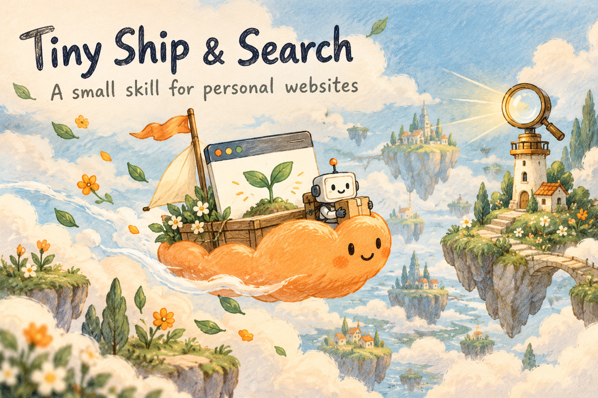

# Tiny Ship & Search

**A small skill for personal websites.**

Publish a small personal website on Cloudflare Pages, then let your agent check what actually happened: the live page, discovery files, Google Search Console verification, sitemap submission, and the indexing status it can observe.

This is a deliberately short workflow, made from personal project experience. Its purpose is to make the last few publishing steps repeatable and easy to remember.

**Deploy → inspect production → check search setup → verify ownership → submit → report evidence.**

  

## What this adds

Cloudflare deployment skills already exist, including [Cloudflare's skills](https://github.com/cloudflare/skills) and OpenAI's [cloudflare-deploy](https://github.com/openai/skills/tree/main/skills/.curated/cloudflare-deploy). This project focuses on one small follow-through: check the real production site and carry the verification through to Google Search Console, with a truthful result for each step.

The workflow favors the existing free plan and supports the Pages dashboard for a simple static site. A paid domain is optional. Cloudflare's [current plan limits](https://developers.cloudflare.com/pages/platform/limits/) still apply.

## What the agent verifies

| Step | Evidence to look for |
| --- | --- |
| Publish | Cloudflare success and the intended version on the production URL |
| Open | The live page renders; its main link or action works |
| Inspect | Relevant robots directives, canonical URL, title, and description |
| Discover | The sitemap contains real production URLs and serves XML |
| Verify ownership | Search Console explicitly accepts the chosen method |
| Submit | The observed sitemap submission and processing states |
| Check indexing | The exact URL's indexed result, separately from a live test or request |

The agent uses the browser and connected tools available in its environment. This package has no bundled account integration or background service. Login, verification challenges, or missing permissions may require the owner; the agent should record that checkpoint and complete every independent check it can.

**A deployed website, an accepted sitemap, and an indexing request are different outcomes.** Google decides whether and when to crawl or index a page. This skill never promises inclusion or ranking. [Google explains this limitation](https://developers.google.com/search/docs/crawling-indexing/ask-google-to-recrawl).

## Use it

Give your agent [SKILL.md](SKILL.md), or place this folder in the skills location supported by your agent under the name `publish-cloudflare-search-console`. The name comes from the skill's frontmatter; the repository's friendly name is Tiny Ship & Search.

Example request:

> Use $publish-cloudflare-search-console to publish my personal static website to its existing Cloudflare Pages project, using the free plan. Verify the actual production page and search setup, complete the authorized Search Console steps you can access, and report evidence for each stage. Show anything still pending.

For an already published site:

> Use $publish-cloudflare-search-console to check this production URL without changing it. Tell me which public checks pass and which Google Search Console steps still need account evidence.

This is an instruction-based skill. It needs a capable agent with access to the project, a way to inspect HTTP responses and the rendered website, and authorized account access for Cloudflare and Search Console. It requires no paid SEO tool or dedicated API key. It is not a standalone app or an npm package.

## 中文介绍

**这是一个非常简短的个人项目 skill：把小网站发布到 Cloudflare，再把搜索配置与 Google Search Console 的验证步骤接起来。**

做完个人网站后，很容易忘记最后几步：生产网址是否真的是最新版？网页、robots 和 sitemap 能不能正常访问？Google 验证文件是否部署正确？Search Console 有没有确认所有权、收到 sitemap？实际收录状态是什么？

这个 skill 把这些步骤整理成一条小链路，让 agent 在现有工具和权限内逐步执行、自己检查结果，并留下可核对的记录。适合个人小网站，优先沿用免费方案。需要你登录或完成验证时，会写清楚停在哪一步。

**“已上线”“已提交”“已确认收录”分别报告。** 提交给 Google 后，是否收录、什么时候收录，由 Google 决定。

## Files

- [SKILL.md](SKILL.md): the short agent workflow.
- [agents/openai.yaml](agents/openai.yaml): optional agent UI metadata.
- [references/result-template.md](references/result-template.md): a compact evidence record.
- [assets/cover.png](assets/cover.png) and [assets/tiny-ship.gif](assets/tiny-ship.gif): the little cloud boat artwork.
- [references/artwork.md](references/artwork.md): artwork prompts and generation notes.

## Official references

- [Cloudflare Pages Direct Upload](https://developers.cloudflare.com/pages/get-started/direct-upload/)
- [Cloudflare Pages preview deployments](https://developers.cloudflare.com/pages/configuration/preview-deployments/)
- [Search Console ownership verification](https://support.google.com/webmasters/answer/9008080)
- [Build and submit a sitemap](https://developers.google.com/search/docs/crawling-indexing/sitemaps/build-sitemap)
- [URL Inspection](https://support.google.com/webmasters/answer/9012289)
- [Ask Google to recrawl](https://developers.google.com/search/docs/crawling-indexing/ask-google-to-recrawl)

Documentation checked on October 16, 2026. Recheck provider guidance when running the skill; interfaces and limits can change.

Personal open-source project by [tina1yan](https://github.com/tina1yan). Not affiliated with Cloudflare or Google. [MIT License](LICENSE).

## ChatGPT personal Skill exports

The existing root `SKILL.md` is preserved. The latest separately installable ChatGPT Skill export is published here:

- [Publish Cloudflare & Search Console](skills/publish-cloudflare-search-console/SKILL.md) — current ChatGPT Skill export, including the read-only [site checker](skills/publish-cloudflare-search-console/scripts/check_site.py).

This Skill is an instruction bundle, not a pre-authenticated session. They grant no credentials, permissions, or automatic background execution.
